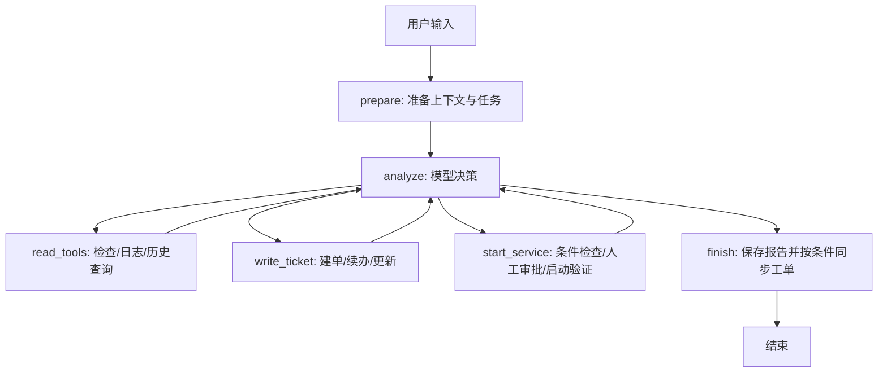

# 故障排查与工单处理 Agent

基于 **Python + LangGraph** 的本地故障排查与工单管理 Agent。通过模型选择工具、收集证据、人工审批、复查和本地持久化，串联同一故障的多轮处理。

> **排查 → 创建工单 → 关联后续处理 → 验证 → 更新工单状态。**
>
> 当前为模型生成分析，程序负责工具白名单、参数校验、审批和状态更新。

## 核心能力

- **证据采集**：健康接口检查、端口诊断、固定日志读取。
- **模型工具循环**：模型根据问题选择工具，依据实际返回结果继续决策并生成分析。
- **人工审批**：仅允许在符合条件且本次人工批准后启动固定目标服务；执行前重新检查，执行后独立验证。
- **任务档案**：每轮保存问题、工具结果、事件与分析，可查询历史。
- **工单生命周期**：创建工单、按编号跨线程续办、记录备注与负责人、根据健康证据更新状态。
- **可视化调试**：正式 `service_agent` 接入 Studio，查看节点、状态与审批中断。

**执行完成不等于服务恢复；服务恢复不等于根因已确认。** 工单的“待处理 / 待验证 / 已恢复”与本轮任务的执行状态分开管理。

## 流程



节点与工具通过 Python 代码注册，Studio 用于运行、观察和审批。框架不自动提供排障能力，也不允许从任意失败节点安全重放操作。

## 环境与安装

当前已使用的环境：**Windows、PowerShell、Python 3.13.14**。其他操作系统尚未验证，启动脚本为 Windows PowerShell 脚本。

本仓库提供两份依赖记录：

| 文件 | 范围 |
| --- | --- |
| `requirements-graph.txt` | 终端图入口的直接依赖 |
| `requirements-graph.lock.txt` | 全量自动测试所用环境的依赖快照 |
| `requirements-studio.lock.txt` | 正式 Studio 所用环境的依赖快照，包含 CLI / API / runtime |

这些是已安装环境的版本快照；**全新机器从零安装尚未验收**，不承诺所有平台都可直接重建。Studio 快照包含 Windows 依赖，不能直接作为跨平台锁文件。

在克隆后的仓库根目录，按下列方式准备各自环境：

```powershell
# Studio 运行环境
py -3.13 -m venv .venv-studio
& .\.venv-studio\Scripts\python.exe -m pip install -r requirements-studio.lock.txt

# 自动测试及终端图环境
py -3.13 -m venv .venv-graph
& .\.venv-graph\Scripts\python.exe -m pip install -r requirements-graph.lock.txt
```

## 模型连接

当前 `ai_client.py` 使用以下代码常量：

| 配置 | 默认值 |
| --- | --- |
| Base URL | `http://127.0.0.1:7863/v1` |
| Model | `cn:deepseek-v4.1-flash` |
| 请求路径 | `/v1/chat/completions` |
| 密钥来源 | 进程环境变量 `WORKBUDDY_API_KEY` |

需要自行准备具有工具调用能力的兼容模型接口。仓库不包含反代程序、账号或密钥；这里的模型标识是现有反代配置值，不保证其他提供方支持。

如使用其他接口，修改 `ai_client.py` 中 `BASE_URL` 与 `MODEL`，并相应调整测试中的接口配置断言；当前未将它们实现为环境变量配置项。

## 启动正式 Agent

先启动自己配置的模型反代，再在仓库根目录运行：

```powershell
powershell.exe -NoProfile -ExecutionPolicy RemoteSigned -File .\start-agent-studio.ps1 -AskKey -Port 2025
```

1. 按提示在本机隐藏输入密钥，不提交到仓库。
2. 打开脚本输出的 Studio 地址。
3. 选择 **service_agent**，新建线程，在 **Question** 输入需求。
4. 查看 `answer`、`task_id`、`report`，以及适用时的 `ticket`、`active_ticket_id`。

脚本默认只监听本机。2025 已占用时拒绝启动，不会杀掉其他进程。已运行正式服务器时不必重复启动；关闭浏览器不会停止它，退出须在承载服务器的终端操作。

| 本地端口 | 用途 |
| --- | --- |
| 7863 | 默认模型反代 |
| 2025 | LangGraph 开发服务器 |
| 18080 | 被检查的目标服务 |

`service.py` 与 `demo_dependency.py` 是正式工具及测试依赖的受控目标环境，并非独立教学项目。端口18080尚未占用且需要正常目标服务时，可在单独终端运行：

```powershell
& .\.venv-graph\Scripts\python.exe .\service.py
```

若该端口已有进程，不要重复启动或自动终止它。日志工具读取固定的 `service.log`；独立手工运行服务时，不应假定标准输出已自动写入该文件。

## 使用

### 只读排查

> 检查一下本机测试服务，必要时查看日志，告诉我当前状态和建议。不要建单、不要启动或修改服务。

### 排查并建单

> 服务访问不了，帮我排查并创建一张工单。检查服务并查看日志，不要启动或修改服务。

### 同单续办

> 再检查一下当前服务，把结果追加到刚才的工单，不要新建，也不要启动或修改服务。

跨线程需提供真实工单编号：先“列出工单”，再“继续处理”对应编号。`get_ticket` 是查询，不等于 `continue_ticket` 续办；不存在的编号不会自动创建替代工单。

### 人工处理后验证

只有确实人工处理过，才要求记录处理说明并复查。用户声明只是处理记录，不是独立验证结果；健康检查决定是否恢复。未提供的负责人和根因保留“待指定”“待确认”。

### 启动审批

用户请求启动且程序确认满足条件时，出现 `start_service_approval` 中断。

在**当前中断的恢复输入**中提交 `批准` / `同意`，或 `拒绝` / `不同意` / `不批准` / `取消`。不是在 Question 新开一轮聊天。后端支持文字审批，客户端仍可能显示 JSON 编辑器；兼容 `{"approve": true}` / `{"approve": false}`。

批准后仍重新检查。端口已开放但健康失败时，不重复启动，更不会停止或重启现有服务。旧审批不能授权新操作。

## 工具与数据

| 分类 | 工具 |
| --- | --- |
| 服务只读 | `check_service`、`diagnose_service`、`read_service_log` |
| 任务查询 | `list_tasks`、`get_task` |
| 工单查询 | `list_tickets`、`get_ticket` |
| 工单写入 | `create_ticket`、`continue_ticket`、`update_ticket` |
| 受限服务操作 | `request_start_service` |

工单写工具每轮最多一次，且单独调用。写入工单不会取得服务操作权限。

- `data/tasks.sqlite3`：每轮独立任务档案。
- `data/tickets.sqlite3`：同一故障的多轮工单记录。
- Studio 检查点由开发服务器管理，不与终端图检查点互通。
- 输出 `report` 不等于自动导出了独立报告文件。
- 工单工具仅接入正式 Studio，原终端 `--chat` / `--graph` 不具备这套工单工具。

## 代码结构

| 文件 | 职责 |
| --- | --- |
| `studio_agent.py` | 正式图、Studio适配、工单节点和审批 |
| `graph_agent.py` | 状态管理、模型循环、工具路由及终端图流程 |
| `ai_check.py` / `ai_client.py` | 共享证据规则、对话入口及模型HTTP连接 |
| `tool_runner.py` | 只读工具白名单与分发 |
| `check_service.py` / `diagnose_service.py` / `read_service_log.py` | 健康、端口和日志证据采集 |
| `recover_service.py` | 固定服务启动限制与复查 |
| `task_store.py` / `task_query_tools.py` | 任务归档与查询 |
| `ticket_store.py` / `ticket_tools.py` | 工单状态、存储及工具参数校验 |
| `report_service.py` | 报告整理与导出 |
| `service.py` / `demo_dependency.py` | 本机目标服务与可控依赖 |
| `test_*.py` | 自动测试 |

## 验证

在仓库根目录运行：

```powershell
& .\.venv-graph\Scripts\python.exe -B -X utf8 -m unittest discover -v
```

本次发布目录完整回归：371项通过；另使用 Studio 环境复跑29项 Studio 测试，全部通过（与完整回归有重叠，不相加）。详细验证范围见 `CODEX_CHANGELOG.md`。

自动测试包含模拟模型响应和隔离环境，**不等于真实模型成功率**。本地开发过程中已有工单建单、复查、人工处理后恢复、跨线程续办及复发状态回转实测，但个人运行记录与工单数据不随公开仓库发布。规则基线对照、真实模型重复评测、全新环境安装仍未完成。

## 安全与限制

- 不执行任意命令、不读任意路径、不自动修改配置、不杀进程、不重启已运行服务。
- 检查成功只代表采样时刻，不是持续监控或根因证明。
- 模型分析保留原文，仍可能推断错误，需要核对证据；提示词约束不是可靠性保证。
- 问题、必要上下文、工具结果及按需读取的日志会发送给配置的模型接口。本地反代不代表模型也在本机。
- 启动脚本关闭 tracing/analytics 相关开关，不保证浏览器、反代与模型提供方均不记录数据。
- 本地脱敏不是加密或完备防泄露方案。不要在问题、日志、Issue 中提交凭据。
- 数据库、日志、检查点、报告、虚拟环境均不入库。仅忽略文件还不足以保证安全，提交前应复查差异。
- 未提供多用户鉴权、正式关单、外部工单平台、生产部署或长期可靠性保证。
