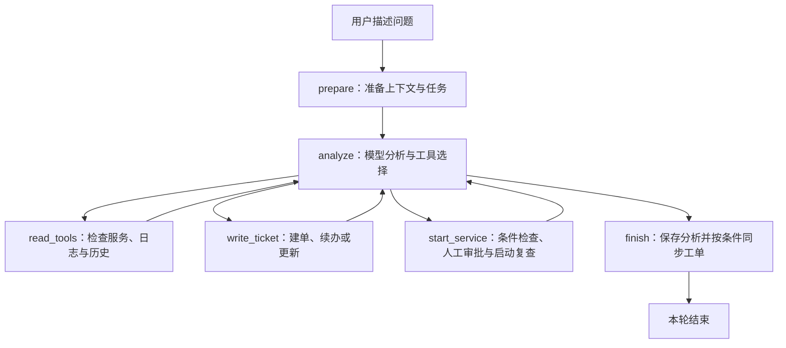

# Incident Ticket Agent

## 故障排查与工单处理 Agent

基于 **Python + LangGraph** 构建的本地故障排查与工单管理 Agent。用户用自然语言描述问题，Agent 调用工具获取健康状态、端口和日志证据，生成分析，并围绕同一张工单持续记录处理过程与复查结果。

**目标：让故障处理不止于一段分析，而是形成“排查 → 建单 → 续办 → 验证 → 状态更新”的完整记录。**

> 当前为本地开发版本，不是生产运维平台。模型负责分析与工具选择，程序负责参数校验、工具权限、人工审批和数据持久化。

## 核心功能

| 功能 | 说明 |
| --- | --- |
| 自然语言交互 | 用自然语言发起排查、查询历史或继续处理工单 |
| 故障证据采集 | 检查健康接口、诊断端口、读取固定服务日志 |
| 多轮工具调用 | 模型根据工具结果继续检查，并结合证据生成分析 |
| 人工审批 | 符合条件时暂停流程，获得本次批准后才能启动固定目标服务 |
| 操作后复查 | 启动后重新检查健康状态，不以启动命令执行成功代替恢复验证 |
| 任务归档 | 保存每轮的问题、工具结果、执行事件与分析 |
| 工单持续跟踪 | 创建工单、查询与续办、记录负责人及备注、按检查证据更新状态 |
| 可视化调试 | 在 Studio 查看正式图、节点状态及审批中断 |

### 三类记录各司其职

- **排障报告**：说明本轮查到了什么、判断依据是什么、建议如何处理。
- **任务档案**：记录本轮 Agent 做过哪些操作、取得哪些结果。
- **工单**：围绕同一故障，持续关联后续处理与验证结果。

**Agent 本轮执行完成，不等于工单已解决；健康检查通过，也不等于根因已经确认。** 工单的“待处理 / 待验证 / 已恢复”与任务执行状态分开管理；未知负责人和根因保留“待指定”“待确认”。

## 工作流程



节点与路由在 Python 代码中定义。Studio 用于运行、观察与恢复审批中断，不替代实际工具实现。

## 技术组成

- **Python**：模型 HTTP 调用、工具执行、数据校验与测试。
- **LangGraph**：状态管理、节点路由、工具循环与人工审批中断。
- **SQLite**：本地任务档案与工单持久化。
- **Studio**：查看图执行过程与调试状态。
- **unittest**：覆盖工具行为、审批流程、归档与工单状态逻辑。

## 快速开始

### 1. 安装依赖

已验证的开发环境为 **Windows + PowerShell + Python 3.13.14**。在仓库根目录执行：

```powershell
# 正式 Studio 入口
py -3.13 -m venv .venv-studio
& .\.venv-studio\Scripts\python.exe -m pip install -r requirements-studio.lock.txt

# 自动测试及终端图入口
py -3.13 -m venv .venv-graph
& .\.venv-graph\Scripts\python.exe -m pip install -r requirements-graph.lock.txt
```

依赖文件为已有环境的版本快照，全新机器从零安装尚未验收。Studio 快照包含 Windows 依赖，不是跨平台锁文件。

### 2. 配置模型接口

准备支持工具调用、兼容 `/v1/chat/completions` 请求格式的模型接口。在 `ai_client.py` 中按自己的服务设置：

| 配置项 | 作用 |
| --- | --- |
| `BASE_URL` | 模型接口基础地址，通常以 `/v1` 结尾 |
| `MODEL` | 接口提供方支持的模型标识 |

这两个配置目前是代码常量，不是环境变量。仓库中的默认值不一定适用于你的环境。密钥通过启动脚本隐藏输入，或由进程环境变量 `WORKBUDDY_API_KEY` 提供；该变量名是现有实现保留的读取名称。**不要把真实密钥写入代码或提交到仓库。**

### 3. 启动 Agent

确认模型接口可访问后执行：

```powershell
powershell.exe -NoProfile -ExecutionPolicy RemoteSigned -File .\start-agent-studio.ps1 -AskKey -Port 2025
```

1. 按提示输入密钥。
2. 打开终端输出的 Studio 地址。
3. 选择 **service_agent**，新建线程，在 **Question** 输入需求。
4. 查看 `answer`、`task_id`、`report`，以及适用时的 `ticket`、`active_ticket_id`。

脚本默认只监听本机。端口已占用时应先核对现有服务，或换一个未占用的端口。关闭浏览器不会停止本地服务器；在启动终端按 `Ctrl+C` 退出。

### 4. 本地检查目标

工具当前面向固定的本地服务，健康接口位于 `http://127.0.0.1:18080/health`，并非任意服务器管理工具。

`service.py` 和 `demo_dependency.py` 是运行与回归测试所需的本地目标及可控依赖。若需要手工启动目标，确认 18080 端口未被占用后执行：

```powershell
& .\.venv-graph\Scripts\python.exe .\service.py
```

日志工具读取固定的 `service.log`。独立手工运行时，不能假定终端输出已经写入该文件。

## 使用示例

### 只读排查

> 检查一下本机服务，必要时查看日志，告诉我当前状态和建议。不要建单、不要启动或修改服务。

### 排查并建单

> 服务访问不了，帮我排查并创建一张工单。检查服务并查看日志，不要启动或修改服务。

### 继续处理同一张工单

> 再检查一下当前服务，把结果追加到刚才的工单，不要新建，也不要启动或修改服务。

跨线程续办时需要提供实际工单编号。可以先列出工单，再明确要求继续处理其中一张。查询工单不等于续办；不存在的编号不会自动生成替代工单。

### 人工处理后验证

> 我已经完成了人工处理，请记录我提供的处理说明，再检查服务，并更新这张工单。

请只记录实际执行过的操作。用户提供的处理说明是陈述，不是独立验证证据；Agent 仍需重新检查，不能仅凭“处理好了”标记恢复。

### 人工审批

当请求启动且满足程序限制时，流程会在 `start_service_approval` 暂停。在**当前中断的恢复输入**中提交 `批准` / `同意`，或 `拒绝` / `不同意` / `不批准` / `取消`，而不是在 Question 新开一轮。

后端支持文字审批；客户端可能仍显示 JSON 编辑器，兼容 `{"approve": true}` / `{"approve": false}`。

批准后仍会重新检查。端口已开放但健康失败时，不会重复启动，也不会停止或重启现有进程。一次批准不授权后续新操作。

## 工具与存储

| 分类 | 工具 |
| --- | --- |
| 服务只读 | `check_service`、`diagnose_service`、`read_service_log` |
| 任务查询 | `list_tasks`、`get_task` |
| 工单查询 | `list_tickets`、`get_ticket` |
| 工单写入 | `create_ticket`、`continue_ticket`、`update_ticket` |
| 受限服务操作 | `request_start_service` |

工单写工具每轮最多一次，且单独调用；写入工单不会取得服务操作权限。

- `data/tasks.sqlite3`：保存每轮任务档案。
- `data/tickets.sqlite3`：保存工单及处理记录。
- Studio 检查点由开发服务器管理，不与终端图检查点互通。
- 状态字段 `report` 不等于已导出独立报告文件。
- 完整工单工具接入正式 Studio；终端 `--chat` / `--graph` 不具备这套工单工具。

## 主要代码

| 文件 | 职责 |
| --- | --- |
| `studio_agent.py` | 正式图入口、Studio 适配、工单节点与审批 |
| `graph_agent.py` | 状态、模型循环、路由与终端图流程 |
| `ai_check.py` / `ai_client.py` | 共享证据规则、对话入口与模型连接 |
| `tool_runner.py` | 只读工具白名单与分发 |
| `check_service.py` / `diagnose_service.py` / `read_service_log.py` | 健康、端口和日志检查 |
| `recover_service.py` | 固定目标服务的受限启动与复查 |
| `task_store.py` / `task_query_tools.py` | 任务归档与查询 |
| `ticket_store.py` / `ticket_tools.py` | 工单存储、状态与参数校验 |
| `report_service.py` | 报告整理与导出 |
| `test_*.py` | 自动回归测试 |

## 测试与验证

```powershell
& .\.venv-graph\Scripts\python.exe -B -X utf8 -m unittest discover -v
```

2026-11-16 首次发布时，在发布目录执行完整回归 **371 项通过**；另用 Studio 环境复跑 **29 项通过**，与前者重叠，不累计。详细记录见 `CODEX_CHANGELOG.md`。

自动测试使用模拟模型响应及隔离资源，不代表真实模型成功率或生产可靠性。全新环境安装、其他系统、真实模型重复评测与长期运行仍需进一步验证。

## 安全边界与当前限制

- 不执行任意命令、不读取任意路径、不自动修改配置、不终止进程、不重启已运行的服务。
- 健康检查只说明采样时刻的状态，不等于持续监控或根因证明。
- 模型生成的分析可能不准确，需要核对工具证据；提示词约束不是可靠性保证。
- 问题、必要上下文、工具结果和按需读取的日志会发送给配置的模型接口，应按接口提供方的数据政策评估使用范围。
- 启动脚本关闭相关 tracing/analytics 开关，但不保证所有组件均不记录数据。
- 脱敏不是加密，也不是完备的防泄露机制。不要在问题、日志或 Issue 中提交凭据。
- 数据库、日志、报告、检查点和虚拟环境不入库；提交前仍需检查差异。
- 当前未提供多用户鉴权、正式关单、外部工单平台集成或生产部署方案。
